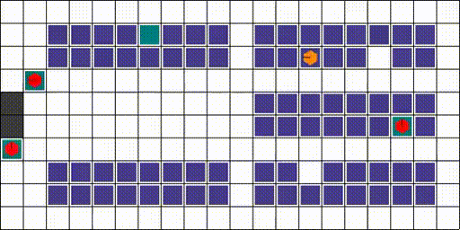
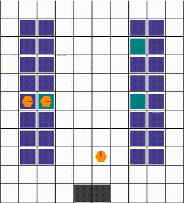
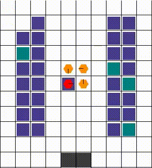
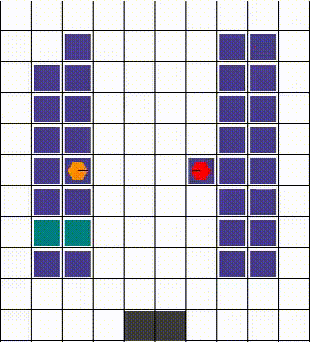
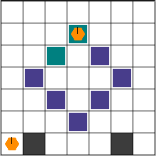

# RWARE experiment of the PGCT repository

This folder holds the multi-robot warehouse environment and every RWARE PGCT experiment (moved here
unchanged from the repository root on 2026-11-05; see `../docs/MIGRATION.md`). The PGCT-D2 algorithm itself
(reward gate, Max-GAE) now comes from the shared package `../PGCT/pgct_core`; `latent_team/reward_probe_ac_v2.py`
and `latent_team/max_gae.py` are thin RWARE adapters over it with the same names, defaults and outputs.

- Run every command **from this folder** (`cd RWARE`); old commands and paths work unchanged relative to it.
  Results go to `RWARE/runs/`; the reference experiment is `runs/sp_20261008_120638_983201/`.
- RWARE-specific parts: environment (`rware/`), trainer (`examples/train_recurrent_ippo_consensus.py`), public
  RWARE probe view and mirror, contact wrapper, candidates (`latent_team/env_candidates.py`), runners.
- Python: the environment documented in `../CLAUDE.md` (`RWARE_MARL`), or any env with `numpy`, `torch`,
  `gymnasium`, `networkx`, `pyglet<2`, `wandb`, `pytest`.

```powershell
cd RWARE
python -m pytest tests -q --basetemp $env:TEMP\rware_pt
```

PGCT-D2 main runs (user-launched, long; plan only shown):

```powershell
powershell -ExecutionPolicy Bypass -Command "& '.\latent_team\run_main_amax_v2.ps1' -Candidate b6_corner_indiv_comm5_pen005 -Seeds 1,2,3 -PlanOnly"
```

Smoke check of the PGCT-D2 path (64 steps, no W&B):

```powershell
python latent_team\train_from_scratch.py --env-variant b6_corner_indiv_comm5_pen005 --modes ippo pgct_max --reward-probe-ac --ac-gate v2 --ac-distance action_max --ac-config latent_team\acv2_nomirror.json --seeds 1 --timesteps 64 --smoke-test --output-dir runs\smoke_pgct_d2_check
```

Migration regression (pre-split frozen copies vs refactored code; exact equality):

```powershell
python -m pytest tests\test_pgct_core_equivalence.py -q --basetemp $env:TEMP\rware_eq
python tests\characterize_pgct_d2.py $env:TEMP\rware_fingerprints_new
```

Experiment documentation: `latent_team/README.md`, `../docs/MAX_GAE.md`, `../docs/REWARD_PROBE_AC.md`,
`../docs/ALGORITHM.md`. The upstream RWARE environment README follows.

---

<p align="center">
 
 <p align="center">A multi-agent reinforcement learning environment</p>
</p>

[](https://GitHub.com/Naereen/StrapDown.js/graphs/commit-activity)
[](https://github.com/Naereen/StrapDown.js/blob/master/LICENSE)

> [!CAUTION]
> The RWARE environment was updated to support the new [Gymnasium](https://gymnasium.farama.org/) interface in replacement of the deprecated `gym=0.21` dependency (many thanks @LukasSchaefer). For backwards compatibility, please see [Gymnasium compatibility documentation](https://gymnasium.farama.org/content/gym_compatibility/) or use version v1.0.3 of the repository. The main changes to the interface are as follows:
> - `obss = env.reset()` --> `obss, info = env.reset()`
> - `obss, rewards, dones, info = env.step(actions)` --> `obss, rewards, done, truncated, info = env.step(actions)`
> - `done` is given as single boolean value instead of one `bool` value per agent
> - You can give the reset function a particular seed with `obss, info = env.reset(seed=42)` to initialise a particular episode.


<h1>Table of Contents</h1>

- [Environment Description](#environment-description)
  - [What does it look like?](#what-does-it-look-like)
  - [Action Space](#action-space)
  - [Observation Space](#observation-space)
  - [Dynamics: Collisions](#dynamics-collisions)
  - [Rewards](#rewards)
- [Environment Parameters](#environment-parameters)
  - [Naming Scheme](#naming-scheme)
  - [Custom layout](#custom-layout)
- [Latent Multi-Team Environments](#latent-multi-team-environments)
- [Installation](#installation)
- [Getting Started](#getting-started)
- [Human Play](#human-play)
- [Please Cite](#please-cite)


# Environment Description

The multi-robot warehouse (RWARE) environment simulates a warehouse with robots moving and delivering requested goods. The simulator is inspired by real-world applications, in which robots pick-up shelves and deliver them to a workstation. Humans access the content of a shelf, and then robots can return them to empty shelf locations.

The environment is configurable: it allows for different sizes (difficulty), number of agents, communication capabilities, and reward settings (cooperative/individual). Of course, the parameters used in each experiment must be clearly reported to allow for fair comparisons between algorithms.

## What does it look like?

Below is an illustration of a small (10x20) warehouse with four trained agents. Agents have been trained with the SEAC algorithm [[2](#please-cite)]. This visualisation can be achieved using the `env.render()` function as described later.

<p align="center">
 
</p>


## Action Space
In this simulation, robots have the following discrete action space:

A={ Turn Left, Turn Right, Forward, Load/Unload Shelf }

The first three actions allow each robot only to rotate and move forward. Loading/Unloading only works when an agent is beneath a shelf on one of the predesignated locations.

## Observation Space
The observation of an agent is partially observable and consists of a 3x3 (configurable) square centred on the agent. Inside this limited grid, all entities are observable:
- The location, the rotation and whether the agent is carrying a shelf.
- The location and rotation of other robots.
- Shelves and whether they are currently in the request queue.

## Dynamics: Collisions
The dynamics of the environment are also of particular interest. Like a real, 3-dimensional warehouse, the robots can move beneath the shelves. Of course, when the robots are loaded, they must use the corridors, avoiding any standing shelves.

Any collisions are resolved in a way that allows for maximum mobility. When two or more agents attempt to move to the same location, we prioritise the one that also blocks others. Otherwise, the selection is done arbitrarily. The visuals below demonstrate the resolution of various collisions.

 Example 1                 |   Example 2               | Example 3
:-------------------------:|:-------------------------:|:-------------------------:
  |    |  

## Rewards
At each time a set number of shelves R is requested. When a requested shelf is brought to a goal location, another shelf is uniformly sampled and added to the current requests. Agents are rewarded for successfully delivering a requested shelf to a goal location, with a reward of 1. A significant challenge in these environments is for agents to deliver requested shelves but also finding an empty location to return the previously delivered shelf. Having multiple steps between deliveries leads a very sparse reward signal.

# Environment Parameters

The multi-robot warehouse task is parameterised by:

- The size of the warehouse which is preset to either tiny (10x11), small (10x20), medium (16x20), or large (16x29).
- The number of agents N.
- The number of requested shelves R. By default R=N, but easy and hard variations of the environment use R = 2N and R = N/2, respectively.

Note that R directly affects the difficulty of the environment. A small R, especially on a larger grid, dramatically affects the sparsity of the reward and thus exploration: randomly bringing the correct shelf becomes increasingly improbable.

## Naming Scheme

While RWARE allows fine tuning of multiple parameters when using the Warehouse class, it also registers multiple default environments with Gymnasium for simplicity.

The registered names look like `rware-tiny-2ag-v1` and might cryptic in the beginning, but it is not actually complicated. Every name always starts with rware. Next, the map size is appended as -tiny, -small, -medium, or -large. The number of robots in the map is selected as Xag with X being a number larger than one (e.g. -4ag for 4 agents). A difficulty modifier is optionally appended in the form of -easy or -hard, making requested shelves twice or half the number of agents (see section Rewards). Finally -v2 is the version as required for Gymnasium. In the time of writing all environments are v1, but we will increase it during changes or bugfixes.

A few examples:
```python
import gymnasium as gym
import rware

env = gym.make("rware-tiny-2ag-v2")
env = gym.make("rware-small-4ag-v2")
env = gym.make("rware-medium-6ag-hard-v2")
```


Of course, more settings are available, but have to be changed during environment creation. For example:
```python
import gymnasium as gym
import rware

env = gym.make("rware-tiny-2ag-v2", sensor_range=3, request_queue_size=6)
```

## Custom layout
You can design a custom warehouse layout with the following:
```python
import gymnasium as gym
import rware

layout = """
.......
...x...
..x.x..
.x...x.
..x.x..
...x...
.g...g.
"""
env = gym.make("rware:rware-tiny-2ag-v2", layout=layout)
```
This will transform "X"s to shelves and "G"s to goal locations with a result like the one below:
<p align="center">
 
</p>


A detailed explanation of all parameters can be found [here](https://github.com/semitable/robotic-warehouse/blob/4307b1fe3afa26de4ca4003fd04ab1319879832a/robotic_warehouse/warehouse.py#L132)

# Latent Multi-Team Environments

This fork adds two environments for latent team discovery experiments:

- `MultiTeamWarehouse`: an RWARE variant where shelves are partitioned into hidden team objectives, and agents receive rewards according to hidden agent-team membership.
- `MultiTeamGrid`: a lightweight synthetic grid where target types are visible, but each agent's rewarded target type/team is hidden.

Team IDs are not included in observations or default `info`. For oracle grouping baselines, call:

```python
team_ids = env.unwrapped.get_oracle_team_assignments()
team_members = env.unwrapped.get_team_members()
```

Recommended Gymnasium IDs:

```python
import gymnasium as gym
import rware

# Small validation
env = gym.make("rware-multiteam-tiny-4ag-2teams-v0")
env = gym.make("mtgrid-small-4ag-2teams-v0")

# Main experiments
env = gym.make("rware-multiteam-small-6ag-2teams-v0")
env = gym.make("rware-multiteam-small-6ag-3teams-v0")
env = gym.make("mtgrid-main-6ag-2teams-v0")
env = gym.make("mtgrid-main-6ag-3teams-v0")

# Scalability
env = gym.make("rware-multiteam-medium-8ag-2teams-v0")
env = gym.make("rware-multiteam-medium-10ag-3teams-v0")
env = gym.make("mtgrid-large-8ag-2teams-v0")
env = gym.make("mtgrid-large-10ag-3teams-v0")
```

Both environments support `msg_bits`, local partial observations, fixed or reset-shuffled hidden teams, and `TeamRewardMode.TEAM`/`INDIVIDUAL`/`ALL` reward modes.

# Installation

Assuming you have Python3 (preferably on a virtual environment: venv or Anaconda) installed, you can use PyPI:
```sh
pip install rware
```

If you prefer to have the code available and be able to edit it, you can use Git to download and install it:
```sh
git clone git@github.com:uoe-agents/robotic-warehouse.git
cd robotic-warehouse
pip install -e .
```

# Getting Started

RWARE was designed to be compatible with Open AI's Gym framework.

Creating the environment is done exactly as one would create a Gym environment:

```python
import gymnasium as gym
import rware
env = gym.make("rware-tiny-2ag-v2")
```

You can even bypass the `import` statement with Gym, and directly use:
```python
import gymnasium as gym
env = gym.make("rware:rware-tiny-2ag-v2")
```
The `rware:` in the beginning of the environment name tells Gym to import the respective package.

The number of agents, the observation space, and the action space are accessed using:
```python
env.n_agents  # 2
env.action_space  # Tuple(Discrete(5), Discrete(5))
env.observation_space  # Tuple(Box(XX,), Box(XX,))
```

The returned spaces are from the Gym library (`gym.spaces`) Each element of the tuple corresponds to an agent, meaning that `len(env.action_space) == env.n_agents` and `len(env.observation_space) == env.n_agents` are always true.

The reset and step functions again are identical to Gym:

```python
obs = env.reset()  # a tuple of observations

actions = env.action_space.sample()  # the action space can be sampled
print(actions)  # (1, 0)
n_obs, reward, done, info = env.step(actions)
print(done)    # False
print(reward)  # [0.0, 0.0]
```
which leaves as to the only difference with Gym: the rewards and the done flag are lists, and each element corresponds to the respective agent.

Finally, the environment can be rendered for debugging purposes:
```python
env.render()
```
and should be closed before terminating:
```python
env.close()
```


# Human Play

We also provide a simple script that allows you to play the environment as a human. This is useful for debugging and understanding the environment dynamics. To play the environment, run the following command:
```sh
python human_play.py --env <env_name>
```
where `<env_name>` is the name of the environment you want to play. For example, to play the tiny environment with 2 agents, run:
```sh
python human_play.py --env rware-tiny-2ag-v2
```

Within the script, you can control a single agent at the time using the following keys:
- Up Arrow keys: move current agent forward
- Left/ Right Arrow keys: rotate current agent left/ right
- P/ L: pickup/ drop shelf
- SPACE: do nothing
- TAB: change the current agent (rotates through all agents)
- R: reset the environment and start a new episode
- H: show help
- D: display agent info (at every time step)
- ESC: exit


# Please Cite
If you use this environment, consider citing
1. A comperative evaluation of MARL algorithms that includes this environment
```
@inproceedings{papoudakis2021benchmarking,
   title={Benchmarking Multi-Agent Deep Reinforcement Learning Algorithms in Cooperative Tasks},
   author={Georgios Papoudakis and Filippos Christianos and Lukas Schäfer and Stefano V. Albrecht},
   booktitle = {Proceedings of the Neural Information Processing Systems Track on Datasets and Benchmarks (NeurIPS)},
   year={2021},
   url = {http://arxiv.org/abs/2006.07869},
   openreview = {https://openreview.net/forum?id=cIrPX-Sn5n},
   code = {https://github.com/uoe-agents/epymarl},
}
```
2. A method that achieves state-of-the-art performance in the robotic warehouse task
```
@inproceedings{christianos2020shared,
 author = {Christianos, Filippos and Sch\"{a}fer, Lukas and Albrecht, Stefano},
 booktitle = {Advances in Neural Information Processing Systems},
 editor = {H. Larochelle and M. Ranzato and R. Hadsell and M. F. Balcan and H. Lin},
 pages = {10707--10717},
 publisher = {Curran Associates, Inc.},
 title = {Shared Experience Actor-Critic for Multi-Agent Reinforcement Learning},
 url = {https://proceedings.neurips.cc/paper/2020/file/7967cc8e3ab559e68cc944c44b1cf3e8-Paper.pdf},
 volume = {33},
 year = {2020}
}

```

